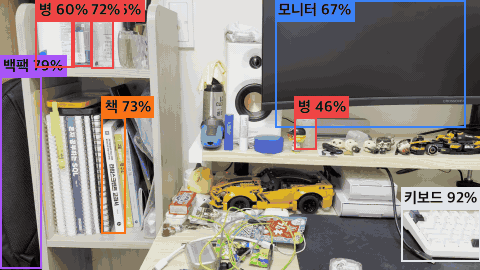
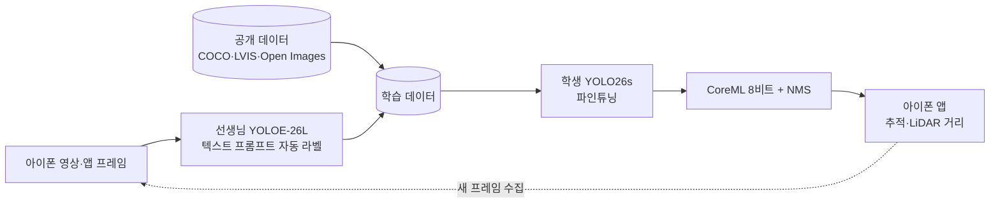

# firstCV — 아이폰 온디바이스 실시간 사물 인식

손에 든 아이폰 카메라로 일상 사물 10종을 **기기 안에서 실시간으로** 인식하는 소형 객체 탐지 모델과, 그 모델을 라벨 없는 상태에서부터 만들어 내는 학습 파이프라인입니다.

<p align="center">
  
  <br><sub>iPhone 16 Pro Max에서 실행 중인 앱 화면 (YOLO26s, CoreML 8비트)</sub>
</p>

## 요약

- **문제**: 큰 비전 모델(SAM 3, YOLOE)은 정확하지만 휴대폰에서 실시간으로 돌릴 수 없다. 들고 걸으며 연속으로 인식하려면 기기 안에서 도는 작은 모델이 필요하다.
- **방법**: 큰 모델을 **선생님**으로 써서 텍스트 프롬프트로 라벨을 자동 생성하고, 그 라벨로 작은 **학생** 모델(YOLO26s, 파라미터 약 1천만 개)을 학습시켜 CoreML로 아이폰에 배포했다.
- **결과**: 아이폰에서 **추론 16ms, 30 FPS, 모델 9.3MB**로 속도·크기 목표는 달성했다. 정확도는 **mAP50 0.44**로 목표(0.7)의 약 60% 수준이다.
- **현재 과제**: 정확도의 병목이 모델 크기가 아니라 **데이터(라벨 품질, 장면 다양성, 공개 데이터와의 도메인 차이)**라는 것을 실험으로 확인했고, 이를 개선하고 있다.

## 인식 클래스 (10종)

처음에는 19종으로 시작했으나, 서로 헷갈리는 짝(텀블러·병)과 경계가 모호한 클래스(옷, 피규어)를 정리해 10종으로 줄였다.

| 클래스 | 현재 mAP50 | 검증 박스 수 | 비고 |
|---|---:|---:|---|
| backpack | 0.78 | 27 | |
| keyboard | 0.70 | 38 | |
| mouse | 0.56 | 10 | 검증 박스가 적어 점수 변동이 큼 |
| bottle | 0.54 | 110 | 10종 체계에서는 tumbler를 bottle로 합침 |
| monitor | 0.52 | 31 | |
| laptop | 0.49 | 80 | |
| cup | 0.32 | 55 | |
| phone | 0.28 | 50 | mouse와 혼동 |
| chair | 0.15 | 19 | |
| book | 0.09 | 78 | 공개 데이터를 섞은 뒤 오히려 하락 (0.26 → 0.09) |
| **평균** | **0.44** | 498 | mAP50-95 0.35 |

> 위 점수는 19클래스로 학습한 현재 배포 모델(`open2_s`)을 10개 클래스에 대해서만 평균한 값이다. 10클래스로 다시 학습한 모델의 결과는 이번 주에 추가한다.

## 현재 성능

| 기준 | 목표 | 현재 | |
|---|---|---|---|
| 속도 | 아이폰 20 FPS 이상 | 30 FPS, 추론 16ms (iPhone 16 Pro Max, Neural Engine) | ✅ |
| 크기 | 10MB 이하 | 9.3MB (CoreML 8비트 양자화, NMS 포함) | ✅ |
| 정확도 | mAP50 0.7 이상 | 0.44 (10클래스) | ❌ |

**평가의 한계 (솔직하게 밝혀 둠)**

- 검증 세트는 학습에 쓰지 않은 별도 영상 1개에서 뽑은 99장이다. 장면이 한 곳에 치우쳐 있다.
- 검증 세트의 정답도 아직 선생님 모델이 만든 라벨이다. 따라서 위 점수는 "실제 정답률"이 아니라 "선생님과의 일치도"에 가깝다. 사람이 검수한 시험 세트를 만드는 것이 다음 작업이다.
- 30 FPS는 카메라 프레임 상한일 가능성이 높아, 실제 여유는 추론 시간(16ms)으로 보는 것이 정확하다.

## 방법



1. **자동 라벨링**: YOLOE에 클래스 이름을 텍스트로 주어 박스를 생성한다. 클래스마다 여러 이름(예: monitor → "computer monitor, screen, display")으로 묻고, 혼동되기 쉬운 물건(리모컨, 침대 등)도 함께 찾게 해 오탐을 줄였다. 휴대폰 방향이 섞인 영상에 대응하려고 이미지를 세 방향으로 돌려 찾은 뒤 합친다.
2. **데이터 구성**: 직접 찍은 영상 프레임과 공개 데이터셋을 섞는다. 공개 데이터셋에 라벨이 없는 클래스는 선생님이 채워, 라벨 없는 물체가 배경으로 학습되지 않게 했다. train/val은 **영상 단위로 분리**해 이웃 프레임이 양쪽에 들어가 점수가 부풀려지는 것을 막았다.
3. **학습**: COCO 사전학습 YOLO26s에서 파인튜닝 (AdamW, lr 0.0005, warmup 3 epoch, mosaic·색·크기 증강, 640px).
4. **배포**: CoreML 8비트 양자화로 18MB → 9.3MB. 앱에서는 프레임 간 박스를 이어 붙이는 트래커로 깜빡임을 줄이고, LiDAR로 물체까지의 거리를 표시한다.
5. **반복 학습 루프**: 앱이 0.5초마다 저장한 프레임을 가져와 라벨링 → 학습 → 기존 모델과 비교 → 더 나으면 아이폰에 자동 설치하는 과정을 스크립트 하나로 자동화했다.

## 시도한 방법과 결과

모든 결과는 같은 검증 세트(99장)에서 잰 값이다.

| # | 시도 | 모델 | mAP50 (19클래스) | mAP50 (10클래스) | 알게 된 것 |
|---|---|---|---:|---:|---|
| 0 | 사전학습 COCO 모델 그대로 사용 | YOLO11n | — | — | 위에서 본 마우스를 휴대폰으로 오인. 소형 모델은 비슷한 모양을 구분하기 어렵다 |
| 1 | 선생님 프롬프트 조합 최적화 | YOLOE | — | — | 사람 라벨이 있는 공개 사진 300장 기준 AP50 0.59 → 0.65 (monitor 0.22 → 0.83). 프롬프트 설계가 라벨 품질을 크게 좌우한다 |
| 2 | 내 영상만으로 학습 (기준선) | YOLO26n | 0.336 | 0.412 | |
| 3 | + 공개 데이터 (COCO·Open Images) | YOLO26n | 0.343 | 0.404 | 공개 사진 수천 장을 더해도 거의 변화 없음 |
| 4 | + LVIS, 내 영상 4배 가중, 학습 설정 고정 | YOLO26n | 0.349 | 0.413 | 공개 사진(정지·잘 찍힌 구도)과 들고 찍은 영상의 **도메인 차이** |
| 5 | 모델 크기 n → s | YOLO26s | **0.369** | **0.442** | 오르긴 하지만 폭이 작다. 검증 손실이 5 epoch 이후 정체 → **용량보다 데이터가 병목** |
| 6 | 19 → 10클래스 재학습 | YOLO26s | — | 진행 중 | 혼동 쌍 제거의 효과 측정 |

**정리**: 데이터 양(공개 데이터 추가)과 모델 크기를 바꿔도 점수가 크게 움직이지 않았다. 남은 원인 후보는 **라벨 품질**(선생님 라벨을 검수하지 않음), **장면 다양성**(촬영 장소 2곳), **흔들린 화면에 대한 대비 부족**이며, 아래 순서로 확인하고 있다.

## 다음 단계

1. **사람이 검수한 시험 세트** 구축 (장소가 다른 영상 3~5개, 클래스당 박스 30개 이상) → "실제 정답률" 측정
2. **10클래스 재학습**으로 클래스 정리 효과 측정
3. **라벨 검수의 효과 측정**: 같은 조건에서 선생님 라벨 vs 사람 검수 라벨로 학습해 비교
4. **액티브 러닝**: 앱 기록의 확신도를 보고 모델이 애매해하는 프레임만 골라 검수
5. **모션 블러 증강**과 걸으며 찍은 구간을 따로 평가

## 더 탐구하고 싶은 질문

- 선생님 모델이 만든 라벨의 노이즈는 학생 모델의 성능 상한을 어떻게 제한하는가? 사람 검수는 어디에 집중할 때 가장 효율적인가?
- 대규모 공개 데이터와 소량의 현장 데이터 사이의 도메인 차이를 줄이려면 어떤 방식(혼합 비율, 2단계 학습, 증강)이 효과적인가?
- 온디바이스 환경에서 정확도와 지연 시간의 균형을 어떻게 설계해야 하는가?

## 실행 환경

| 구분 | 내용 |
|---|---|
| 학습 | MacBook Pro (Apple M3 Max), PyTorch MPS, Ultralytics 8.4 |
| 추론 | iPhone 16 Pro Max (A18 Pro, LiDAR), SwiftUI + Vision + CoreML |
| 데이터 | 직접 촬영 영상 2개 + 앱 수집 프레임 + 공개 데이터 약 4,100장 |
| 라벨 검수 | X-AnyLabeling |

## 저장소 구성

```
scripts/   파이프라인 단계별 스크립트 (촬영·프레임 추출 → 자동 라벨 → 학습 → CoreML 변환 → 반복 루프)
ios/       아이폰 실시간 인식 앱 (SwiftUI + Vision)
notes/     단계별 관찰 기록
docs/      개발 기록(DEVLOG.md), 데모 자료
```

```bash
uv sync
uv run scripts/03_train.py --data mine_open10 --model yolo26s.pt --name mo10_s   # 10클래스 학습
uv run scripts/07_export.py --help                                               # CoreML 변환
```

각 스크립트의 설계 이유, 하이퍼파라미터, 실험별 상세 기록은 [docs/DEVLOG.md](docs/DEVLOG.md)에 있다.
