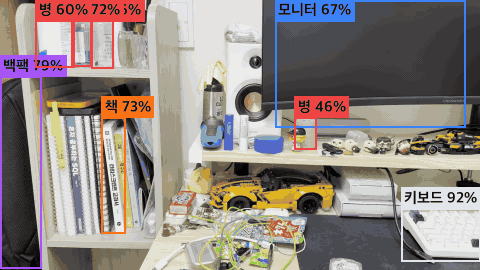
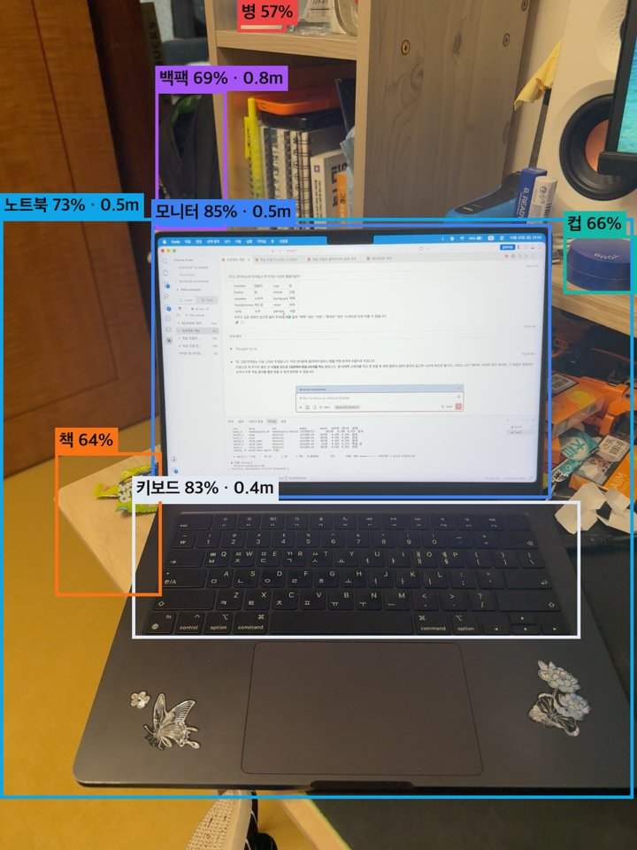
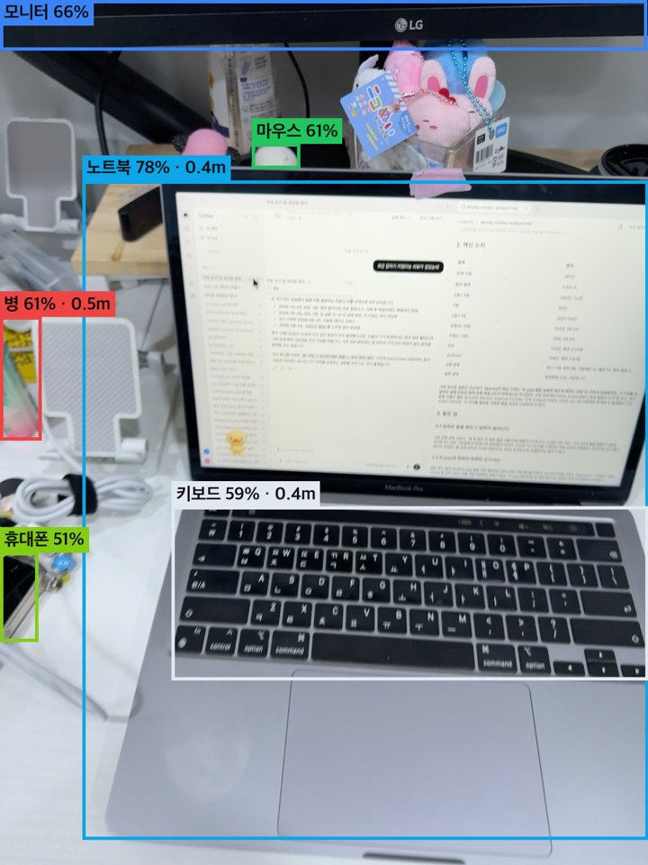
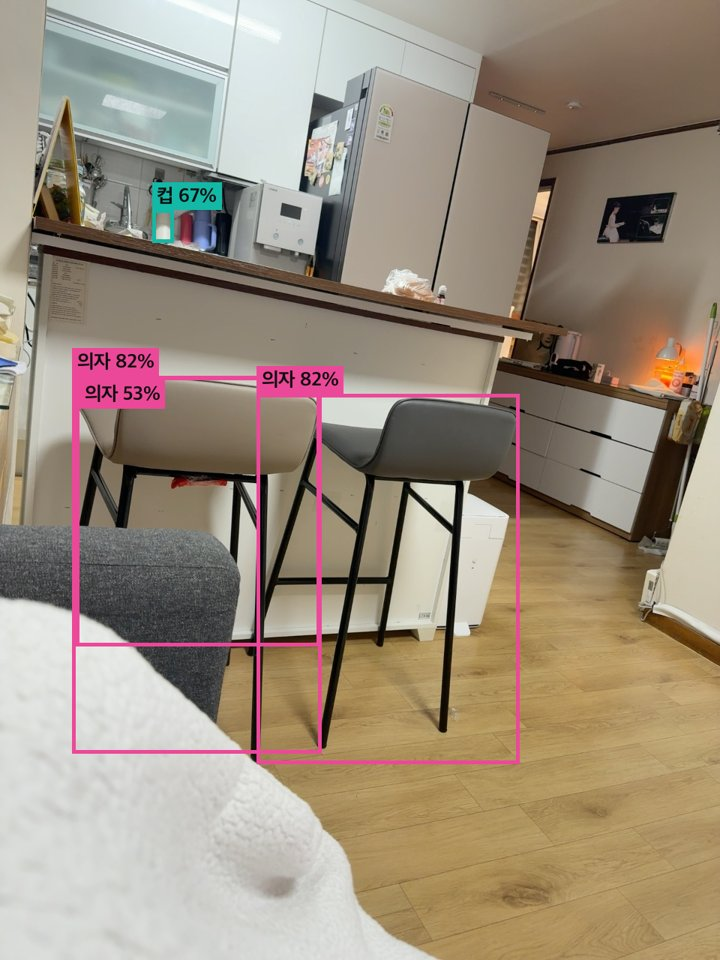
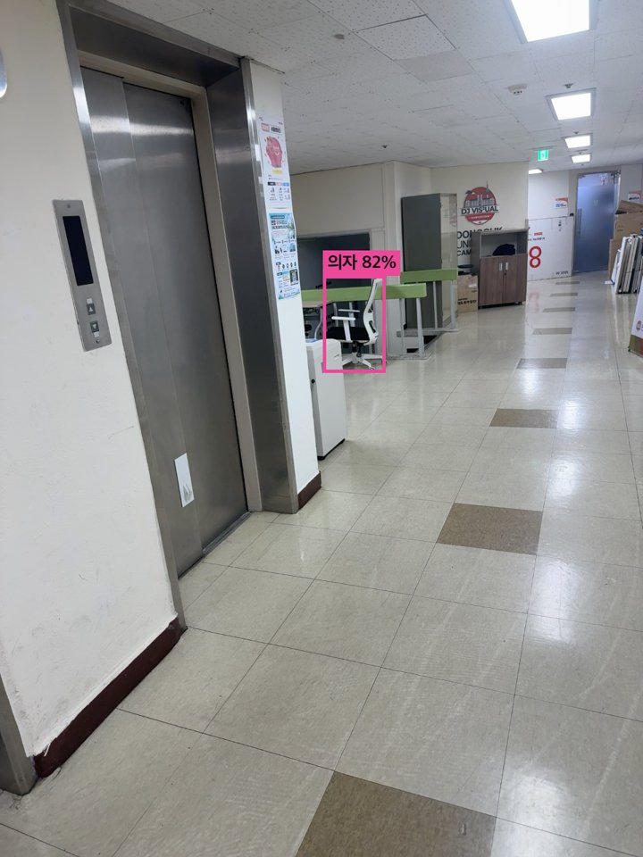
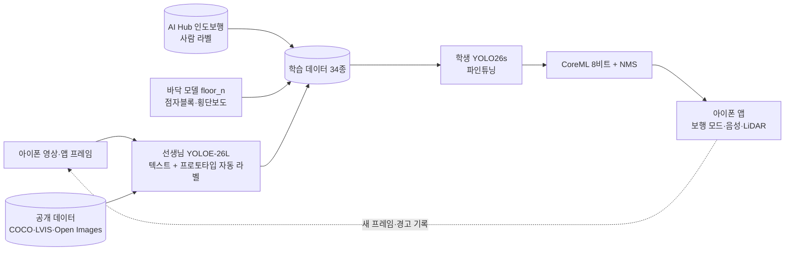

# firstCV — 보행 보조를 위한 아이폰 온디바이스 실시간 사물 인식

손에 든 아이폰 카메라로 걷는 길의 장애물과 주변 사물을 **기기 안에서 실시간으로** 인식해 음성과 진동으로 알려 주는 소형 객체 탐지 모델과 앱, 그리고 그 모델을 라벨 없는 상태에서부터 만들어 내는 학습 파이프라인입니다.

<p align="center">
  
  <br><sub>아이폰으로 책상을 훑으며 찍은 10초 영상에 학생 모델(YOLO26s)을 돌린 결과. 보행 보조로 방향을 바꾸기 전, 실내 사물 10종 단계의 데모다.
  리모컨을 휴대폰으로, 과자 봉지를 마우스로 잡는 순간도 그대로 두었다.</sub>
</p>

<p align="center">
  
  
  
  
  <br><sub>앱이 자동 저장한 프레임 중 장소가 다른 4장. 거리는 앱이 그 순간 LiDAR로 잰 값이다.
  1번처럼 노트북 화면을 모니터로도 잡는 오류가 아직 남아 있다.</sub>
</p>

## 요약

- **문제**: 큰 비전 모델(SAM 3, YOLOE)은 정확하지만 휴대폰에서 실시간으로 돌릴 수 없다. 걸으면서 바로바로 알려 주려면 기기 안에서 도는 작은 모델이 필요하다.
- **방법**: 큰 모델을 **선생님**으로 써서 텍스트 프롬프트로 라벨을 자동 생성하고, 사람이 라벨을 단 한국 인도 데이터(AI Hub)를 더해 작은 **학생** 모델(YOLO26s, 파라미터 약 950만 개)을 학습시켰다. 학습한 모델은 CoreML로 아이폰에 배포했다.
- **앱**: LiDAR 깊이와 중력 방향으로 걷는 통로의 장애물과 낙차(내려가는 계단·턱)를 찾는다. 다가오는 사람이나 탈것도 함께 찾고, 모델이 본 이름을 붙여 진동과 음성으로 경고한다.
- **결과**: 아이폰에서 **추론 약 14ms, 모델 9.4MB**로 속도·크기 목표는 달성했다. 사람 라벨이 있는 인도 검증 사진에서 최신 모델은 보행 장애물 13종 **mAP50 0.64**다(목표 0.7).
- **현재 과제**: 실내 사물 점수는 낮다(0.30). 보행 모드 경고가 실제로 맞는지 재는 현장 지표도 아직 없다.

## 앱이 하는 일

| 기능 | 작동 방식 |
|---|---|
| 장애물 경고 | LiDAR 깊이 지도를 3차원 점으로 되돌리고 중력 방향으로 높이를 잰다. 몸 앞 폭 70cm 통로 안에서 바닥보다 15cm 이상 솟은 것을 장애물로 본다. 2m에서는 화면에만 표시하고, 1.2m에서 약한 진동과 "앞 1.1미터 의자", 0.6m에서 강한 진동과 "멈추세요"를 알린다. 모델이 모르는 물건(벽, 상자)도 잡힌다 |
| 낙차 경고 | 같은 통로에서 바닥보다 15cm 이상 꺼진 곳(내려가는 계단, 턱)을 찾는다. 넘어지면 더 위험해서 3m·2m·1m로 더 일찍 알린다 |
| 다가오는 물체 | 사람·자전거·차·오토바이가 내 걷는 속도를 빼고도 빠르게 다가와 3초 안에 닿으면 "오른쪽에서 자전거 다가와요"라고 알린다 |
| 물건 안내 | 확신도 70% 이상, 3m 이내, 5프레임 이상 보인 것 중 가장 가까운 하나만 "왼쪽 1.2미터, 의자"처럼 말한다 |
| 화면 안정화 | 트래커가 프레임마다 나오는 박스를 이어 붙인다. 움직임을 예측하고 이름은 투표로 정해 박스가 깜빡이거나 튀지 않게 한다 |
| 데이터 수집 | 0.5초마다 원본 프레임과 성능 기록을 저장한다. 경고가 울린 순간의 사진과 "경고 놓침" 버튼 기록도 따로 남긴다 |

## 인식 클래스 (34종)

| 묶음 | 클래스 | 라벨 출처 |
|---|---|---|
| 보행 장애물 | person, door, stairs, bicycle, car, motorcycle, pole, table, trash can, bench, traffic cone, chair | 선생님 + AI Hub 사람 라벨 |
| 한국 인도 | bollard, tree trunk, braille block(점자블록), crosswalk(횡단보도) | AI Hub 사람 라벨 |
| 실내 사물 | monitor, laptop, keyboard, figure, toy car, tumbler, bottle, speaker, headphones, clothes, cap, book, mouse, phone, cup, shoes, backpack, sofa | 선생님 |

처음에는 실내 사물 19종으로 시작했다. 2026-10-27 활용 방향을 **보행 보조**로 정하면서 걷는 길의 장애물 10종을 더했고, 2026-10-30 AI Hub 인도 데이터를 쓰면서 한국 인도 4종을 더했다.
점자블록과 횡단보도는 선생님이 거의 못 찾아서(AP50 0.05, 0.03) AI Hub 사람 라벨만 쓴다. 사람 라벨이 없는 사진에는 이 두 클래스만 따로 학습한 작은 모델(`floor_n`, mAP50 0.64)로 채운다.

## 현재 성능

### 속도·크기 (아이폰에 설치된 `walk_s`)

| 기준 | 목표 | 현재 | |
|---|---|---|---|
| 속도 | 아이폰 20 FPS 이상 | 처리 속도 중앙값 62 FPS, 추론 13.6ms (상위 10% 19.6ms) | ✅ |
| 크기 | 10MB 이하 | 9.4MB (CoreML 8비트 양자화, NMS 포함) | ✅ |

측정 기기는 iPhone 16 Pro Max(Neural Engine)이고, 2026-10-27~29 앱 기록 294프레임으로 쟀다.

### 정확도 (mAP50, 2026-10-31 같은 검증 세트로 다시 채점)

| 검증 세트 | 정답 | `walk_s` (설치됨, 30종) | `walk34_s` (최신, 34종 + AI Hub) |
|---|---|---:|---:|
| **AI Hub 인도, 보행 장애물 13종** (1,874장) | **사람 라벨** | 0.34 (9종, 새 4종은 모름) | **0.64** |
| AI Hub 인도, 전체 23종 | 사람 라벨 + 선생님 | 0.27 | 0.51 |
| 내 영상 `촬영본` (99장, 실내 위주) | 선생님 라벨 | 0.28 | 0.30 |

AI Hub 사람 라벨 클래스에서 `walk34_s`의 점수는 다음과 같다.

| 클래스 | mAP50 | 클래스 | mAP50 | 클래스 | mAP50 |
|---|---:|---|---:|---|---:|
| car | 0.88 | crosswalk | 0.74 | stairs | 0.44 |
| person | 0.79 | motorcycle | 0.72 | bench | 0.40 |
| braille block | 0.78 | bollard | 0.72 | chair | 0.40 |
| pole | 0.70 | tree trunk | 0.69 | table | 0.34 |
| bicycle | 0.68 | | | | |

- AI Hub 데이터를 넣자 인도 장애물이 크게 올랐다(같은 9종 평균 0.34 → 0.59). 특히 pole 0.09 → 0.70, stairs 0.15 → 0.44, motorcycle 0.48 → 0.72.
- 실내 사물은 거의 그대로다(0.28 → 0.30). 내 영상 val에서 headphones, clothes, shoes, sofa, toy car는 0.1 미만이다.

**평가의 한계 (솔직하게 밝혀 둠)**

- AI Hub 검증 사진은 학습 사진과 **촬영 폴더(영상) 단위로 분리**했지만, 같은 데이터셋이라 촬영 기기와 지역이 비슷하다. 내 아이폰으로 찍은 인도에서는 점수가 더 낮을 수 있다.
- 내 영상 검증 세트는 영상 1개(99장, 실내)이고 정답이 선생님 라벨이다. 그래서 "실제 정답률"이 아니라 "선생님과의 일치도"에 가깝다.
- 34종으로 라벨을 다시 만들면서 내 영상 val의 정답도 바뀌었다. 그래서 이전 기록(아래 표의 #2~#6)과는 숫자를 직접 비교할 수 없다.
- 보행 모드 경고가 맞았는지(헛경고 비율, 놓친 장애물, 경고 거리)는 기록·검토 도구(`11_walk_review.py`)만 만들었고, 아직 걸으며 잰 기록이 없다.

## 방법



1. **자동 라벨링** (`04`, `10`)
   - YOLOE에 클래스 이름을 텍스트로 주어 박스를 만든다. 클래스마다 여러 이름(예: monitor → "computer monitor, screen, display")으로 묻는다.
   - 혼동되기 쉬운 물건(리모컨, 침대 등)도 함께 찾게 해서 오탐을 줄였다.
   - 글자로 설명하기 어려운 클래스는 사람 라벨 박스의 평균 임베딩(프로토타입)을 함께 준다. 피규어는 AP50이 0.24에서 0.59로, 장난감 자동차는 0.10에서 0.54로 올랐다. 채점해서 효과가 있는 클래스에만 쓴다.
2. **데이터 구성** (`06`, `12`)
   - 직접 찍은 영상 프레임, 공개 데이터셋, AI Hub 인도보행 영상(train 약 1만 8천 장)을 섞는다.
   - 각 데이터셋에 사람 라벨이 없는 클래스는 선생님이 채운다. 라벨 없는 물체가 배경으로 학습되지 않게 하기 위해서다.
   - train/val은 **영상(촬영 폴더) 단위로 분리**했다. 이웃 프레임이 양쪽에 들어가 점수가 부풀려지는 것을 막기 위해서다.
3. **학습** (`03`): COCO 사전학습 YOLO26s에서 파인튜닝한다. 설정은 AdamW, lr 0.0005, warmup 3 epoch, mosaic·색·크기 증강, 입력 640px, 30 epoch다.
4. **배포** (`07`): CoreML 8비트 양자화로 19MB를 9.4MB로 줄였다. 앱은 Vision 대신 CoreML을 직접 호출한다. Vision이 확신도를 클래스 비율로 바꿔 넘겨줘서(44% → 99%) 기준값이 의미 없어졌기 때문이다.
5. **반복 학습 루프** (`08`, `09`): 앱이 저장한 프레임을 가져와 라벨링 → 학습 → 기존 모델과 비교 → 더 나으면 아이폰에 자동 설치하는 과정을 스크립트 하나로 자동화했다.

## 시도한 방법과 결과

| # | 시도 | 모델 | 결과 (mAP50) | 알게 된 것 |
|---|---|---|---:|---|
| 0 | 사전학습 COCO 모델 그대로 사용 | YOLO11n | — | 위에서 본 마우스를 휴대폰으로 오인. 소형 모델은 비슷한 모양을 구분하기 어렵다 |
| 1 | 선생님 프롬프트 조합 최적화 | YOLOE | 0.59 → 0.65 | 사람 라벨이 있는 공개 사진 300장 기준 (monitor 0.22 → 0.83). 프롬프트 설계가 라벨 품질을 크게 좌우한다 |
| 2 | 내 영상만으로 학습 (기준선) | YOLO26n | 0.336 | 내 영상 val, 당시 19종 라벨 기준 (#2~#6 공통) |
| 3 | + 공개 데이터 (COCO·Open Images) | YOLO26n | 0.343 | 공개 사진 수천 장을 더해도 거의 변화 없음 |
| 4 | + LVIS, 내 영상 4배 가중, 학습 설정 고정 | YOLO26n | 0.349 | 공개 사진(정지·잘 찍힌 구도)과 들고 찍은 영상의 **도메인 차이** |
| 5 | 모델 크기 n → s | YOLO26s | 0.369 | 오르긴 하지만 폭이 작다. 검증 손실이 5 epoch 이후 정체 → **용량보다 데이터가 병목** |
| 6 | 보행 장애물 10종 추가 (30종), 프로토타입 선생님 | YOLO26s | 0.461 | 지금 아이폰에 설치된 `walk_s`. 19 → 10종 축소 실험은 방향 전환으로 하지 않았다 |
| 7 | 점자블록·횡단보도 전용 바닥 모델 | YOLO26n | 0.645 | AI Hub 바닥 폴리곤으로 학습. 선생님이 못 찾는 클래스를 작은 전용 모델로 채웠다 |
| 8 | + AI Hub 인도보행 사람 라벨 (34종) | YOLO26s | **0.64** (인도 13종) | 사람 라벨 데이터를 넣자 인도 장애물이 0.34 → 0.59로 크게 올랐다. **데이터 품질이 병목**이라는 #5의 판단과 맞는다 |

**정리**: 공개 데이터 양을 늘리거나 모델 크기를 키워도 점수는 거의 움직이지 않았다. 반면 **목적에 맞는 사람 라벨 데이터**(AI Hub 인도)를 넣자 해당 클래스가 크게 올랐다. 실내 사물이 낮은 것도 같은 원인(선생님 라벨, 단조로운 장면)으로 보고 있다.

## 다음 단계

1. **`walk34_s`를 아이폰에 배포**하고 실제 인도를 걸으며 보행 모드 지표를 잰다. 지표는 헛경고 비율, 놓친 장애물, 경고 거리다(`11_walk_review.py`).
2. **내 아이폰으로 찍은 인도 시험 세트**를 만든다. AI Hub와 다른 기기·지역에서도 점수가 유지되는지 확인한다. 내 영상 val에서 bicycle, car, pole, bench가 0점인 것도 실외 영상이 거의 없어서다.
3. **사람이 검수한 실내 시험 세트**를 만든다(장소가 다른 영상 3~5개, 클래스당 박스 30개 이상).
   - 그 전에 검수한 라벨이 지워지지 않게 고쳐야 한다. 지금은 `04_auto_label.py`가 실행할 때마다 `data/datasets/mine/`을 지우고 새로 만든다.
4. **약한 보행 클래스 보강**: door(0.12)와 traffic cone(0.25)은 AI Hub에 사람 라벨이 없어 선생님 라벨에 의존한다.
5. **액티브 러닝**: 헛경고였던 사진과 모델이 애매해한 프레임만 골라 검수한다.
6. **모션 블러 증강**을 넣고, 걸으며 찍은 구간을 따로 평가한다.

## 더 탐구하고 싶은 질문

- 선생님 모델이 만든 라벨의 노이즈는 학생 모델의 성능 상한을 어떻게 제한하는가? 사람 검수는 어디에 집중할 때 가장 효율적인가?
- 다른 기기·지역에서 찍은 대규모 데이터(AI Hub)와 내 카메라 화면 사이의 도메인 차이는 얼마나 되고, 어떻게 줄일 수 있는가?
- 깊이 센서(LiDAR) 기반의 "모르는 물건도 잡는" 장애물 판단과 모델 기반의 "이름을 아는" 인식을 어떻게 나누고 합치는 게 좋은가?
- 보행 보조에서 정확도(mAP)보다 중요한 지표(헛경고, 놓침, 경고 거리)는 무엇이고, 어떻게 재야 하는가?

## 실행 환경

| 구분 | 내용 |
|---|---|
| 학습 | MacBook Pro (Apple M3 Max, 메모리 36GB), PyTorch MPS, Ultralytics 8.4 |
| 추론 | iPhone 16 Pro Max (A18 Pro, LiDAR), SwiftUI + CoreML |
| 데이터 | 직접 촬영 영상 3개 + 앱 수집 프레임(train 1,348장) + 공개 데이터 6,614장 + AI Hub 인도보행 17,898장 |
| 라벨 검수 | X-AnyLabeling |

AI Hub "인도보행 영상"은 내국인만 신청할 수 있고 재배포가 금지되어 있어 저장소에 포함하지 않는다(`data/`는 git 제외).

## 저장소 구성

```
scripts/   파이프라인 단계별 스크립트
  01~02    카메라 실행, 영상 → 프레임 추출
  03       학습
  04, 10   선생님 자동 라벨, 프로토타입 채점
  05       라벨 검수 (X-AnyLabeling)
  06, 12   공개 데이터, AI Hub 인도 데이터 받기·변환
  07       CoreML 변환 (07_remap_classes는 클래스 축소 사본)
  08~09    앱 데이터 가져오기, 한 바퀴 자동화
  11       보행 모드 경고 검토·지표
  status, jobs, watch_train   진행 상황 보기
ios/       아이폰 앱 (보행 모드, 음성 안내, LiDAR 장애물 감지, 트래커)
notes/     단계별 관찰 기록
docs/      개발 기록(DEVLOG.md), 데모 자료
```

```bash
uv sync
uv run scripts/status.py                                                         # 데이터·학습 현황
uv run scripts/03_train.py --data mine_open_aihub --model yolo26s.pt --name walk34_s --epochs 30
uv run scripts/07_export.py --help                                               # CoreML 변환
uv run scripts/11_walk_review.py                                                 # 보행 경고 검토
```

각 스크립트의 설계 이유, 하이퍼파라미터, 이전 실험의 상세 기록은 [docs/DEVLOG.md](docs/DEVLOG.md)에 있다. DEVLOG는 2026-10-25까지의 기록이다.
