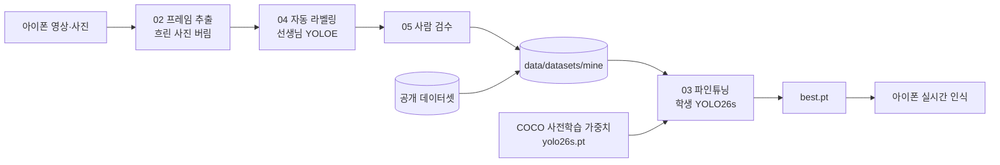
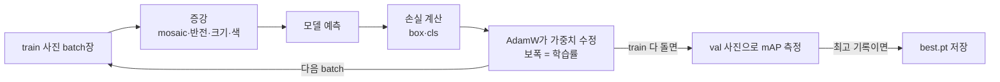
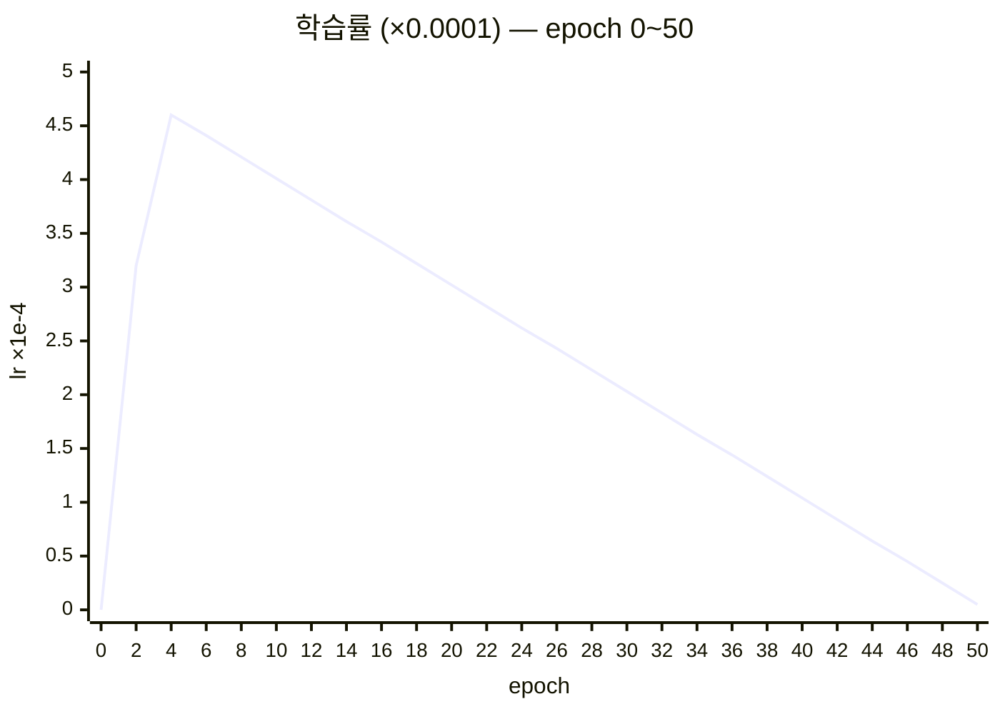

# MSCV — 아이폰 온디바이스 소형 사물 인식 알고리즘

아이폰을 들고 돌아다니면서 화면에 들어오는 **일상 사물을 실시간으로 인식**하는 작은 객체 탐지 모델과, 그 모델을 만드는 학습 파이프라인.
큰 모델이 라벨을 만들고, 10MB 이하의 작은 모델이 그 라벨로 배워 아이폰 안에서 혼자 돈다.

**목표**: 데이터가 하나도 없는 상태에서 시작해 수집 → 라벨링 → 학습 → 개선 → 온디바이스 배포까지
객체 탐지 파이프라인 전체를 직접 돌려본다. 정확도(mAP)와 속도(FPS)는 항상 함께 잰다.

**요구사항**

- 카메라가 계속 움직인다 → 모션 블러, 다양한 거리·각도에서도 버텨야 한다
- 들고 다니며 끊김 없이 볼 수 있을 만큼 빨라야 한다
- 최종 배포는 아이폰 온디바이스(CoreML)

**성공 기준 (초안)**

- 속도: 아이폰에서 20 FPS 이상, 모델 파일 10MB 이하
- 정확도: 직접 찍은 시험 세트(움직이며 촬영)에서 mAP50 0.7 이상

SAM 3, YOLOE 같은 큰 모델은 정확하지만 아이폰에서 실시간으로 돌릴 수 없다.
그래서 큰 모델은 라벨을 만드는 **선생님**으로 쓰고, 그 라벨로 작은 **학생** 모델(YOLO n/s)을 학습시켜 배포한다.

## 작동 방식

### 한눈에 보기

```mermaid
flowchart LR
    subgraph 맥["맥 (학습)"]
        R[아이폰 영상·앱 프레임] --> T[선생님 YOLOE-26L<br/>텍스트 프롬프트로 라벨]
        O[(공개 데이터<br/>LVIS·COCO·Open Images)] --> D
        T --> D[(학습 데이터<br/>20클래스)]
        D --> S[학생 YOLO26s<br/>파인튜닝]
        S --> X[CoreML 8비트 + NMS<br/>9.3MB]
    end
    subgraph 폰["아이폰 (추론)"]
        C[카메라 1280×720] --> M[YOLO26s CoreML<br/>Neural Engine]
        M --> K[트래커<br/>깜빡임 제거]
        K --> L[LiDAR 거리]
        L --> U[화면 표시]
        C -.0.5초마다 저장.-> R
    end
    X -->|09_cycle: 더 나으면 자동 설치| M
```

### 사용한 모델

| 역할 | 모델 | 크기 | 어디서 쓰나 |
|---|---|---|---|
| **학생 (배포)** | YOLO26s, COCO 사전학습에서 파인튜닝 | `.pt` 19MB → CoreML 8비트 9.3MB | 아이폰 앱. 지금 설치된 것은 `runs/open2_s` |
| 학생 (비교용) | YOLO26n | 5.3MB | n/s 비교 실험 ([모델 변경 기록](#모델-변경-기록)) |
| **선생님 (라벨링)** | YOLOE-26L-seg (`yoloe-26l-seg.pt`) | 76MB | `04_auto_label.py`, `06_open_data.py`. 물건 이름(텍스트)을 주면 박스를 찾는다 |
| 관찰용 | YOLO11n/s, YOLOv8n-OIV7, YOLOE-26S 프롬프트 프리 | — | 1단계에서 기성 모델 관찰 |

인식하는 클래스는 20개다: monitor, laptop, keyboard, figure, toy car, tumbler, bottle, speaker, headphones, clothes, cap, book, mouse, phone, cup, shoes, backpack, chair, sofa, person.
(`person`은 최근에 추가했다. 아이폰에 설치된 `open2_s`는 추가 전 19클래스 모델이다.)

### 1) 라벨 만들기: 선생님 모델 (`04_auto_label.py`)

사람이 박스를 하나하나 그리지 않고, 큰 모델(YOLOE)에 물건 이름을 줘서 라벨 초안을 만든다.

- **클래스마다 여러 이름으로 묻는다.** 예를 들어 monitor는 "computer monitor, screen, television, tv, display"로 묻는다. 사람 라벨이 있는 공개 사진 300장으로 이름 조합을 채점해서 골랐다. 평균 AP50이 0.59에서 0.65로 올랐고, 모니터만 보면 0.22에서 0.83으로 올랐다.
- **헷갈리는 물건도 같이 찾고 버린다.** 침대, 리모컨, 상자 같은 물건(`DISTRACTORS`)을 함께 찾게 해야, 선생님이 침대를 소파로, 리모컨을 휴대폰으로 억지로 맞추지 않는다.
- **세 방향으로 돌려서 찾는다.** 원본, 시계방향 90도, 반시계방향 90도로 찾은 뒤 박스를 원래 좌표로 모은다. 폰을 세로·가로로 들고 찍은 사진이 섞여 있기 때문이다.
- **겹친 박스를 정리한다.** 같은 물체에 박스가 여러 개 붙으면 점수 높은 것만 남기고(NMS), 모니터 화면 안에 85% 이상 들어간 박스는 화면 속 장면으로 보고 버린다.
- **train/val은 영상 단위로 나눈다.** 같은 영상의 이웃 프레임은 거의 같아서, 섞어서 나누면 점수가 부풀려진다. `촬영본` 영상과 `test_`로 시작하는 묶음은 채점에만 쓴다.

### 2) 공개 데이터 섞기 (`06_open_data.py`)

LVIS·COCO·Open Images에서 우리 클래스가 들어 있는 사진을 클래스당 최대 400장씩 받는다(train 4,134장).
공개 데이터셋에는 자기 클래스만 라벨이 달려 있다. 그래서 그 데이터셋에 없는 클래스는 선생님이 채운다. 그대로 두면 라벨 없는 헤드폰이 "배경"으로 학습되기 때문이다.
공개 사진이 내 영상보다 훨씬 많으므로, 학습 목록에 내 영상을 4번 넣어 비중을 맞춘다.

### 3) 학생 학습 (`03_train.py`)

COCO로 사전학습된 YOLO26s에서 출발해 작은 학습률로 파인튜닝한다.
설정은 AdamW, lr 0.0005, warmup 3 epoch, mosaic·반전·크기·색 증강, 입력 640px, batch 16이다. 자세한 설계와 그림은 [학습은 어떻게 설계돼 있나](#학습은-어떻게-설계돼-있나)에 있다.
점수는 내 영상 val(`촬영본` 99장)에서만 잰다. 우리가 잘해야 하는 건 공개 사진이 아니라 내 카메라 화면이기 때문이다.

### 4) 아이폰 변환과 추론 (`07_export.py`, `ios/`)

- **변환**: CoreML 8비트 양자화에 NMS까지 모델 안에 넣는다. 크기는 18MB(16비트)에서 9.3MB로 줄었다.
- **카메라**: 후면 LiDAR 카메라에서 1280×720으로 받는다. Vision이 640×640으로 늘려(`scaleFill`) 모델에 넣는다.
- **추론**: `computeUnits = .all`로 Neural Engine을 쓴다. 확신도 기준은 기본 25%이고 화면의 슬라이더로 바꿀 수 있다. NMS의 IoU 기준은 0.45다.
- **트래커** (`Tracker.swift`): 프레임마다 따로 나오는 박스를 이어 붙여, 박스가 깜빡이거나 튀지 않게 한다.
  - 같은 이름이고 IoU 0.3 이상 겹치면 같은 물건으로 보고, 위치를 이전 박스와 반반 섞는다.
  - 처음 보인 물건은 2프레임 연속으로 잡혀야 보여준다. 한 프레임짜리 오탐을 거르기 위해서다.
  - 잡히던 물건을 놓쳐도 6프레임(약 0.2초) 동안은 화면에 남겨 둔다.
- **거리**: 박스 가운데 40% 영역의 LiDAR 깊이 중앙값을 거리(m)로 표시한다. 가장자리는 뒤쪽 배경이 섞이므로 뺀다.
- **기록**: 0.5초마다 원본 프레임과 FPS·추론 시간·탐지 결과를 저장한다. 이것이 다음 학습 데이터가 된다.

### 5) 한 바퀴 자동화 (`09_cycle.py`)

이 스크립트 하나가 다음을 차례로 한다.

1. 앱 프레임 가져오기 (`08`)
2. 자동 라벨 (`04`)
3. YOLO26s 15 epoch 학습
4. 지금 설치된 모델과 같은 val로 mAP50-95 비교
5. 새 모델이 더 나으면 CoreML로 변환해 아이폰에 자동 설치

설치된 모델은 `runs/deployed.json`에 기록된다.

## 실험 환경

| 구분 | 내용 |
|---|---|
| 학습 기기 | MacBook Pro, Apple M3 Max (GPU 30코어), 메모리 36GB, macOS 26.6 |
| 학습 장치 | PyTorch MPS (맥 GPU). YOLO26s 학습은 epoch당 약 5분 (train 약 5,200장, 1.1 it/s) |
| 소프트웨어 | Python 3.12, PyTorch 2.14, Ultralytics 8.4.184, OpenCV 5.0, uv로 환경 관리 |
| CoreML 변환 | 별도 환경: coremltools 9.0 + torch 2.7 + NumPy 1.x (프로젝트 환경과 버전이 안 맞아 분리) |
| 라벨 검수 도구 | X-AnyLabeling 4.2 |
| 촬영·추론 기기 | iPhone 16 Pro Max (A18 Pro, LiDAR). 앱은 iOS 17 이상, SwiftUI + Vision + CoreML |
| 측정 결과 | 아이폰 앱 기록 중앙값 30 FPS, 추론 16ms (앱 세션 2개, 프레임 약 150장) |
| 데이터 | 내 영상 2개(train 262장, val 99장) + 앱 프레임 149장 + 공개 데이터 4,134장 |

## 이 소형 모델은 어디에 쓰나

### SAM 3 같은 큰 모델이 있는데 왜 작은 모델을 만드나

**큰 모델을 대체하려는 게 아니라, 큰 모델의 능력을 실제 기기에서 쓸 수 있게 만드는 작업이다.**
큰 모델은 정답(라벨)을 만들고, 작은 모델은 그 정답을 현장에서 빠르고 싸게 실행한다. 이 프로젝트는 그 둘을 잇는 과정(지식 증류)을 직접 해 본 것이다.

| | SAM 3 (큰 모델) | 우리 학생 모델 (YOLO26s) |
|---|---|---|
| 크기 | 파라미터 약 8억 4천만 개 | **약 950만 개** (약 90배 작음), 파일 9.3MB |
| 속도 | 데이터센터 GPU에서도 한 장에 수십 ms | **아이폰에서 추론 16ms, 30 FPS** |
| 아이폰 실시간 | 사실상 불가능 | 가능 (실측) |
| 아는 범위 | 이름만 주면 거의 무엇이든 찾는다 | 학습한 20클래스만 안다 |
| 쓰는 방식 | "컵을 찾아 줘"처럼 **찾을 대상을 말해 줘야** 찾는다 | 아는 것을 **알아서 전부** 찾는다 |

마지막 줄이 중요하다. SAM 3는 "이 화면에 뭐가 있어?"에 답하는 모델이 아니라 "컵을 찾아 줘"에 답하는 모델이다.
그래서 이 구조에서 큰 모델은 경쟁자가 아니라 **작은 모델을 가르치는 선생님**이다. 큰 모델이 나오면서 라벨링 비용이 거의 사라졌고, 덕분에 용도별 작은 모델을 빠르게 여러 개 만들 수 있게 됐다.

**작은 모델이 필요한 이유**

- **지연**: 서버를 한 번 다녀오면 돌아다니며 바로바로 보는 경험이 안 된다
- **비용**: 카메라는 초당 30장을 찍는다. 매 장을 서버의 큰 모델로 보내면 사용자 수와 시간에 비례해 GPU 비용이 계속 늘어난다. 기기 안의 모델은 추가 비용이 없다
- **개인정보**: 집 안 영상이 기기 밖으로 나가지 않는다
- **오프라인**: 네트워크가 없어도 동작한다

### 쓸 수 있는 곳

실시간으로, 기기 안에서 돌아야 하는 곳이다. 거대 모델을 그대로 쓸 수 없는 자리다.

| 분야 | 예시 | 이 프로젝트와의 연결 |
|---|---|---|
| 스마트폰 카메라 기능 | 비추면 바로 물건 이름·거리를 알려 주는 앱, 시각 보조 | 지금 아이폰 앱이 바로 이 형태다 (사물 + LiDAR 거리) |
| AR 글래스 | 시야 속 물건에 라벨 붙이기 | 같은 모델을 CoreML 그대로 쓸 수 있다 |
| 로봇·드론·자동차 | 주변 물체 인식, 장애물 회피 | 작은 칩에서 돌 크기와 속도가 필요하다 |
| 매장·물류 | 진열대 스캔, 재고 확인 | 클래스만 바꿔 같은 파이프라인으로 학습하면 된다 |
| CCTV 엣지 분석 | 사람·반려동물·차량 감지 | 아래 "소형 CCTV에서 사람 인식" 참고 |

### 소형 CCTV(예: Tapo)에서 사람 인식

- **카메라 안에 직접 넣기는 사실상 불가능하다.** 칩 성능은 된다. Tapo에 이미 사람·반려동물·차량 감지가 들어 있으니, 저가 CCTV 칩에서도 n 크기 모델은 돈다는 증거다.
  하지만 펌웨어가 닫혀 있어서 사용자가 모델을 올릴 방법(SDK)이 없다.
- **영상을 받아 옆 기기에서 돌리는 건 쉽다.**
  ```
  Tapo 카메라 ──(RTSP 영상, 같은 와이파이)──▶ 맥 / 라즈베리파이 / 젯슨 ──▶ YOLO로 사람 인식
  ```
  - 유선 전원 Tapo는 대부분 RTSP를 지원한다(배터리형은 안 되는 경우가 많다). Tapo 앱 → 카메라 설정 → 고급 설정 → 카메라 계정을 만들면 `rtsp://아이디:비밀번호@카메라IP:554/stream2`(저화질)로 받을 수 있다.
  - 상시로 돌리려면 라즈베리파이 5 + AI 가속기나 젯슨 오린 나노 같은 저전력 기기를 쓴다. 오픈소스 NVR인 Frigate가 이 구조다.
  - 사람은 COCO 사전학습 모델이 이미 잘 잡는 클래스라 따로 학습하지 않아도 된다. 지금 모델에도 `person` 클래스를 넣었다.
  - 아직 구현하지 않았다. `01_webcam_yolo.py`의 `--camera`가 RTSP 주소도 받게 몇 줄만 고치면 된다. 비밀번호는 코드나 git에 남지 않게 환경 변수로 받는다.

### 작은 모델이 답이 아닌 경우

**실시간이 필요 없거나, 1~2초 지연이 괜찮거나, 사용량이 적다면** 사진을 Claude·GPT 같은 비전 언어 모델 API나 큰 모델에 보내는 게 더 정확하고 쉽다.
이 프로젝트는 "들고 돌아다니며 연속으로 인식"이 목표라서 작은 모델 쪽을 골랐다. 이 판단 기준을 먼저 인정하고 설명하는 게 중요하다.

### 한 문단으로 설명하기

> SAM 3는 정확하지만 파라미터가 8억 개가 넘어서, 휴대폰이나 카메라 기기에서 실시간으로 돌릴 수 없습니다. 서버로 보내면 지연, 서버 비용, 개인정보, 오프라인 문제가 생깁니다.
> 그래서 큰 모델(YOLOE)로 라벨을 만들고, 그 라벨로 950만 파라미터짜리 YOLO26s를 학습시켜 아이폰에 올렸습니다.
> 결과는 9.3MB, 추론 16ms, 30 FPS입니다. 정확도는 아직 mAP50 0.37로 목표(0.7)의 절반이고, 사람 검수와 클래스 정리로 올리고 있습니다.

마지막 정확도 숫자는 [다음에 할 일](#다음에-할-일)을 진행하면서 갱신한다. SAM 3와 직접 비교한 숫자(같은 프레임에서 속도·정확도)는 아직 재지 않았다.
SAM 3 가중치는 Hugging Face에서 접근 신청을 해야 받을 수 있다.

## 로드맵

- [x] **1. 기성 모델 써보기** — 사전학습 YOLO를 아이폰 카메라에 돌려보고, 무엇을 잘 잡고 무엇을 놓치는지 관찰 ([기록](notes/01-pretrained-yolo.md))
- [x] **2. 손으로 작게 한 바퀴** — 직접 찍고 100~200장 라벨링 → YOLO 파인튜닝 → mAP·FPS 측정
- [ ] **3. 자동 라벨링** — SAM 3.1 텍스트 프롬프트로 라벨 초안 → 검수만 → 데이터 10배 *(검수만 남음)*
- [ ] **4. 극한으로 밀기** — 틀린 프레임 모아 재라벨링(액티브 러닝), 블러·조명 증강, 공개 데이터셋 섞기 *(공개 데이터만 끝남)*
- [x] **5. 경량화·실시간** — CoreML 변환, 아이폰에서 실시간 인식
- [ ] **6. 결과 정리** — 단계별 mAP·FPS 그래프, 데모 영상, 회고

### 단계별 진행 상황 (2026-10-25 기준)

| 단계 | 상태 | 실제로 한 것 | 처음 계획과 다른 점·남은 것 |
|---|---|---|---|
| 1. 기성 모델 | ✅ 완료 | `01_webcam_yolo.py`로 yolo11n/s 관찰. 맥에서 프레임당 약 70ms, nano가 마우스를 폰으로 착각 | 노트의 "관찰"은 아직 짧다 |
| 2. 작게 한 바퀴 | ✅ 완료 | 영상 2개(`녹화2` 262장 → train, `촬영본` 99장 → val)로 파인튜닝. `mine_n` mAP50 0.545 | 손 라벨링 대신 4단계의 자동 라벨을 바로 썼다 |
| 3. 자동 라벨링 | 🟡 일부 | `04_auto_label.py`로 YOLOE(`yoloe-26l-seg`)가 19클래스 라벨 초안. 공개 데이터까지 합쳐 사진이 510장에서 약 4,600장으로 9배 | SAM 3.1 대신 YOLOE를 썼다. **사람 검수는 0장**(검수 JSON 없음) |
| 4. 극한으로 밀기 | 🟡 일부 | 공개 데이터(LVIS·COCO·Open Images 4,134장) 섞기, 앱 데이터를 다시 학습에 넣는 루프(`08`→`09`) | 공개 데이터로는 mAP50이 0.002만 올랐다. 틀린 프레임만 골라내기, 모션 블러 증강은 아직 없다 |
| 5. 경량화·실시간 | ✅ 완료 | `open2_s`를 CoreML 8비트+NMS로 변환(9.3MB), iOS 앱에 설치. 앱 기록 중앙값 **30 FPS, 추론 16ms** | 30 FPS는 카메라 프레임 상한일 가능성이 크다. 추론 16ms면 여유가 있다 |
| 6. 결과 정리 | ⬜ 시작 전 | — | 그래프, 데모 영상, 회고 모두 남음 |

### 성공 기준 대비

| 기준 | 목표 | 지금 (`open2_s`, 아이폰에 설치됨) | 판정 |
|---|---|---|---|
| 속도 | 아이폰 20 FPS 이상 | 30 FPS (앱 기록 중앙값, 추론 16ms) | ✅ |
| 크기 | 10MB 이하 | 9.3MB (8비트+NMS) | ✅ |
| 정확도 | 움직이며 찍은 시험 세트 mAP50 0.7 이상 | 0.369 | ❌ 절반 수준 |

속도와 크기는 통과했다. **남은 문제는 정확도 하나다.** 게다가 지금 0.369는 사람이 확인한 정답이 아니라 선생님(YOLOE) 라벨과 비교한 점수다.
그래서 "진짜 점수"부터 알아야 한다.

## 아쉬운 점과 해결 방법

지금 정확도(mAP50 0.37)가 목표의 절반인 이유를 데이터, 라벨, 평가, 실험 관리로 나눠 적었다. 숫자는 2026-10-25 기준이다.

### 1. 내 데이터가 적고 장면이 단조롭다

- **문제**
  - 내가 찍은 데이터는 영상 2개와 앱 세션 2개뿐이다(train 411장).
  - 이웃 프레임끼리 거의 같아서, 실제로 서로 다른 장면은 수십 개 수준이다. 방 한두 곳, 비슷한 조명, 같은 물건 몇 개만 반복해서 본 셈이다.
  - 클래스마다 양도 고르지 않다. 내 train에서 bottle은 박스 706개인데 headphones 82개, toy car 86개, cap 92개, mouse 96개다.
- **해결**
  - 장소(방, 사무실, 카페, 야외), 시간대(낮, 밤 조명), 거리와 각도를 바꿔 짧은 영상을 여러 개 찍는다. 같은 길이라면 긴 영상 하나보다 서로 다른 짧은 영상 여러 개가 낫다.
  - 박스가 적은 클래스(headphones, toy car, cap, mouse)는 그 물건만 따로 여러 번 찍는다.
  - 앱을 켜 두기만 하면 프레임이 쌓이는 루프(`08`→`09`)가 이미 있으니, 다양한 장소에서 앱을 켜는 것만으로 데이터가 늘어난다.

### 2. 라벨을 사람이 한 장도 확인하지 않았다

- **문제**
  - 모든 라벨이 선생님(YOLOE) 초안 그대로다. 선생님이 틀린 것은 학생도 그대로 배운다.
  - 데이터 양만으로는 설명되지 않는 클래스가 있다. 예를 들어 shoes는 내 데이터 384개와 공개 데이터 2,928개로 박스가 많은데도 mAP50이 0.06이다.
    이건 양보다 라벨 품질이나 "무엇을 shoes로 볼지"의 기준 문제일 가능성이 크다.
  - 검수를 해도 `04_auto_label.py`를 다시 돌리면 지워지는 구조다.
- **해결**
  - 검수 결과를 보존하도록 04를 고친다.
  - val부터 검수하고, 그다음 점수가 낮은 클래스(shoes, book, chair, sofa, figure)의 train 라벨을 검수한다.
  - 선생님이 클래스별로 얼마나 정확한지도 잰다. 이미 공개 사진 300장으로 프롬프트를 채점하는 방법을 쓰고 있으니, 이를 내 영상 검수본에도 적용한다.

### 3. 시험 세트가 작고 정답도 믿을 수 없다

- **문제**
  - val은 `촬영본` 영상 하나에서 뽑은 99장이다. 장면 하나에 치우쳐 있다.
  - 클래스별 박스가 cap 8개, clothes 8개, mouse 9개, sofa 9개뿐이라, 박스 한두 개만 맞거나 틀려도 클래스 점수가 크게 흔들린다.
  - val 정답도 선생님 라벨이다. 그래서 0.37은 "선생님과 얼마나 닮았나"이지 "실제로 얼마나 맞나"가 아니다.
  - `09_cycle.py`는 이 점수를 보고 아이폰에 새 모델을 자동 설치한다.
- **해결**
  - 앱의 **시험용 모드**(`test_`)로 장소가 다른 시험 영상을 3~5개 더 찍는다.
  - 시험 세트는 반드시 사람이 검수한다.
  - 클래스마다 박스가 최소 30개 이상 들어가게 맞춘다.
  - 시험 세트 검수가 끝나기 전까지는 자동 설치 판정을 참고용으로만 본다.

### 4. 공개 데이터가 내 카메라 화면과 다르다

- **문제**
  - 공개 데이터 4,134장을 넣었는데 mAP50은 0.002만 올랐다.
  - 공개 사진은 대부분 사람이 잘 구도 잡아 찍은 정지 사진이다. 들고 걸으며 찍은 흔들린 세로 화면과는 분위기가 다르다(도메인 차이).
  - person이 박스 9,980개로 공개 데이터의 약 30%를 차지해 학습이 사람 쪽으로 쏠릴 수 있다. toy car는 공개 데이터에 42개밖에 없다.
- **해결**
  - 공개 데이터는 "보조"로 두고 내 영상 비중을 높인다. 지금은 4번 반복해서 넣고 있는데, 이 반복 횟수를 바꿔 가며 비교한다.
  - person 같은 큰 클래스는 클래스당 상한을 둔다.
  - 공개 데이터를 넣은 것과 뺀 것을 같은 시험 세트로 비교해, 실제로 도움이 되는 클래스만 남긴다.

### 5. 움직이는 화면에 대한 대비가 약하다

- **문제**
  - 요구사항은 "들고 다니며 인식"인데, `02_extract_frames.py`는 흐린 프레임을 오히려 **버린다**.
  - 학습 증강에도 블러가 없다. 실제 사용 환경에서 가장 자주 만날 흔들린 화면을 거의 배우지 못하고 있다.
- **해결**
  - 흐린 프레임 일부를 일부러 남긴다. 사람이 봐도 물건을 알아볼 수 있는 정도까지만 남긴다.
  - 학습할 때 모션 블러 증강을 넣는다.
  - 시험 세트에도 걸으면서 찍은 구간을 넣어, 흔들림에 얼마나 강한지 따로 잰다.

### 6. 클래스 설계가 애매하다

- **문제**
  - tumbler와 bottle, phone과 mouse처럼 비슷하게 생긴 짝이 있다.
  - figure, clothes처럼 경계가 모호한 클래스도 있다.
  - 클래스 수가 19개에서 20개(person 추가)로 바뀌어서 이전 run과 바로 비교하기 어렵다.
- **해결**
  - 10클래스 버전(`mine10`, tumbler → bottle 합침)으로 학습해 19클래스와 비교한다.
  - 클래스마다 "무엇을 이 클래스로 볼지" 기준을 한 줄씩 정해 `notes/`에 적는다. 검수할 때 이 기준을 따른다.

### 7. 실험 기록과 비교가 엄밀하지 않다

- **문제**
  - `mine_n`(0.545)과 `mine2_n`(0.336)은 같은 `mine/val`이라는 이름을 쓰지만, 그사이 val 내용이 바뀌어서 점수를 서로 비교할 수 없다.
  - 실험마다 한 번씩만 돌렸다. 0.022 같은 작은 차이가 우연인지 진짜인지 모른다.
  - 아이폰 30 FPS는 카메라 프레임 상한일 가능성이 커서, 모델이 실제로 얼마나 여유가 있는지 알 수 없다.
  - 스크립트 번호 `07`이 두 개다(`07_remap_classes`, `07_export`).
- **해결**
  - 시험 세트를 고정하고 버전을 붙인다(예: `test_v1`). run 기록에 어떤 시험 세트로 쟀는지 함께 남긴다.
  - 중요한 비교는 seed를 바꿔 2~3번 돌린다.
  - 아이폰에서는 FPS보다 추론 시간(ms)을 주 지표로 보고, n과 s를 같은 조건에서 잰다.
  - 스크립트 번호를 정리한다.

### 8. 아직 재지 않은 것

- SAM 3와 같은 프레임에서 속도와 정확도를 직접 비교한 숫자가 없다. "왜 작은 모델인가"를 숫자로 보여 주려면 필요하다.
- 아이폰에서 오래 켜 뒀을 때의 발열, 배터리, 속도 저하를 재지 않았다.
- 무료 개발자 서명이라 7일마다 앱을 다시 설치해야 한다. 오래 쓰려면 유료 개발자 계정이 필요하다.

## 다음에 할 일

중요한 순서대로 적었다. 위 [아쉬운 점](#아쉬운-점과-해결-방법)의 해결 방법을 실행 순서로 바꾼 것이다.

1. **검수한 라벨이 지워지지 않게 고치기** (검수 전에 꼭 먼저)
   - 지금은 `08_pull_app.py`가 매번 `04_auto_label.py`를 다시 돌린다. 그런데 04는 `data/datasets/mine/`을 통째로 지우고 새로 만든다(`shutil.rmtree`).
     이 상태로 검수하면 다음 사이클 때 검수한 내용이 전부 사라진다.
   - 방법: 검수한 사진 목록을 따로 기록해 두고, 04는 새 사진과 아직 검수하지 않은 사진만 다시 라벨링하게 바꾼다.
2. **val 99장(`촬영본`) 사람 검수 → 진짜 점수 다시 재기**
   - `uv run scripts/05_review.py open` → 고치기 → `save`. 그다음 `open2_n`·`open2_s`를 다시 채점한다.
   - 이 숫자가 있어야 0.7까지 얼마나 남았는지 알 수 있다. 선생님 라벨 자체가 틀린 거라면 학생 점수는 실제보다 낮게 나온다.
3. **클래스를 19개에서 10개로 줄여 학습** (`mine10`, `open10` 데이터는 이미 만들어 둠)
   - `uv run scripts/03_train.py --data mine_open10 --model yolo26s.pt --name mo10_s`
   - n → s로 바꿔도 0.022만 올랐다. 그러니 용량보다 클래스 구성(헷갈리는 짝, 사진이 적은 클래스)이 병목일 가능성이 크다.
4. **약한 클래스에 데이터 보태기**
   - shoes 0.06, book 0.10, chair 0.10, sofa 0.13, figure 0.13. 이 물건들을 여러 거리와 각도에서 따로 찍는다.
   - 시험 세트용 영상도 하나 더 찍는다(이름을 `test_`로 시작). 지금 val은 영상 하나뿐이라 점수가 장면 하나에 치우친다.
5. **액티브 러닝 제대로 하기**
   - 지금 루프는 앱 프레임을 전부 가져온다. 앱 기록(`data/app_logs/*.csv`)의 확신도를 보고 **애매하거나 틀린 프레임만** 골라 검수하도록 바꾼다.
6. **모션 블러 증강 추가**
   - 요구사항이 "들고 다니며 인식"인데, 지금 증강에는 색·크기·반전만 있다. 학습할 때 블러를 넣어 흔들린 화면에서도 버티게 한다.
7. **결과 정리 (6단계)**
   - run별 mAP·FPS 그래프, 아이폰 화면 녹화 데모 영상, `notes/`에 단계별 회고

## 시작하기

```bash
cd ~/Developer/firstCV
uv sync
uv run scripts/01_webcam_yolo.py --list-cameras   # 카메라 번호 확인
uv run scripts/01_webcam_yolo.py --camera 1       # 아이폰(연속성 카메라)으로 탐지
```

- 처음 실행하면 macOS가 터미널(또는 VS Code)의 카메라 접근 권한을 물어본다. 허용하고 다시 실행한다.
- 아이폰은 맥과 같은 Apple ID로 로그인돼 있으면 연속성 카메라로 무선 연결된다. 보통 1번, 맥 내장 카메라는 0번.
- 모델 가중치(`*.pt`)는 처음 실행할 때 자동으로 내려받는다.

## 스크립트

| 파일 | 하는 일 |
|---|---|
| `scripts/01_webcam_yolo.py` | 카메라에 사전학습 YOLO 실행, 화면에 FPS 표시. `s` 원본 프레임 저장, `q` 종료 |
| `scripts/02_extract_frames.py` | 폰 영상에서 일정 간격으로 프레임 추출, 흐린 프레임은 자동으로 버림 |
| `scripts/03_train.py` | 공개 데이터셋(기본 HomeObjects-3K)이나 `--data mine`으로 사전학습 YOLO 파인튜닝. 결과는 `runs/<이름>/weights/best.pt` |
| `scripts/04_auto_label.py` | 선생님 모델(YOLOE)에 물건 이름을 줘서 `data/raw` 사진에 라벨 초안. 결과는 `data/datasets/mine/`, 미리보기는 `mine/preview/` |
| `scripts/05_review.py` | 자동 라벨을 X-AnyLabeling으로 검수(`open`)하고 YOLO 라벨로 되돌림(`save`) |
| `scripts/06_open_data.py` | LVIS(Hugging Face)·COCO·Open Images에서 우리 클래스 사진만 받아 학습 데이터에 보탬 |
| `scripts/07_remap_classes.py` | 19클래스 데이터를 10클래스로 줄인 사본(`mine10`, `open10`, `mine_open10`) 만들기. 비슷한 짝은 합침 |
| `scripts/07_export.py` | 학습한 모델을 아이폰용 CoreML(16비트/8비트)로 변환. 실행 명령은 파일 안 설명 참고 |
| `scripts/08_pull_app.py` | 아이폰 앱이 저장한 프레임을 가져와 `data/raw`에 추가하고 자동 라벨까지 반영 (학습은 안 함) |
| `scripts/09_cycle.py` | 한 바퀴: 앱 데이터 가져오기 → 라벨 → 학습(yolo26s) → 깔린 모델과 비교 → 더 나으면 아이폰에 자동 설치 |
| `scripts/status.py` | 프로젝트 전체 현황: 로드맵 체크, 데이터·라벨 수, 검수 진행, run별 epoch·best mAP·상태 |
| `scripts/watch_train.py` | 학습 진행 상황(epoch, 남은 시간, mAP, loss) 요약. 학습 중 다른 터미널에서 실행 |

자주 쓰는 옵션:

```bash
uv run scripts/01_webcam_yolo.py --camera 1 --model yolo11s.pt --conf 0.4   # 모델·임계값 바꾸기
uv run scripts/01_webcam_yolo.py --camera 1 --no-detect                     # 탐지 없이 촬영만 (데이터 수집)
uv run scripts/02_extract_frames.py data/videos/walk1.mov --every 0.5        # 0.5초마다 한 장
uv run scripts/02_extract_frames.py data/videos/walk1.mov --min-sharpness 0  # 블러 필터 끄기
uv run scripts/03_train.py --epochs 3 --fraction 0.1                         # 학습 빠르게 한 바퀴
uv run scripts/01_webcam_yolo.py --camera 1 --model runs/home_n/weights/best.pt  # 학습한 모델로 확인
```

## 학습은 어떻게 설계돼 있나

값은 모두 [`scripts/03_train.py`](scripts/03_train.py)의 `HYPERPARAMS`에 주석과 함께 있다. 여기는 그림으로 보는 요약이다.

### 전체 흐름: 선생님이 라벨을 만들고 학생이 배운다



처음부터 학습하지 않는다. COCO로 이미 사물을 볼 줄 아는 모델에서 출발해 우리 클래스에 맞게 **조금만** 고친다(파인튜닝).
그래서 학습률을 작게(0.0005) 둔다. 크게 하면 원래 알던 것까지 망가진다.

### 1 epoch 안에서 일어나는 일



- **증강**은 같은 사진을 매번 조금씩 바꿔 보여주는 것이다. 사진이 적을수록 중요하다. val 사진에는 증강을 하지 않는다.
- **mAP**는 val 사진에서 박스를 얼마나 맞게 쳤는지 나타내는 점수다(0~1). `best.pt`는 이 점수가 가장 높았던 epoch의 가중치다.

### 50 epoch 동안 학습률은 이렇게 바뀐다



- **0~3 epoch (warmup)**: 0에서 0.0005까지 천천히 올린다. 처음엔 예측이 엉망이라 기울기가 커서, 바로 큰 보폭으로 가면 사전학습 가중치가 망가진다.
- **3~50 epoch**: 직선으로 줄여 마지막엔 처음의 1%(`lrf=0.01`)가 된다. 처음엔 크게 배우고 끝으로 갈수록 미세 조정한다.

### 단계별로 켜지고 꺼지는 것

```mermaid
gantt
    title 50 epoch 타임라인
    dateFormat X
    axisFormat %s
    section 학습률
    warmup (올리기)        :0, 3
    직선 감소              :3, 50
    section 증강
    mosaic 켬 (4장 이어붙이기) :0, 40
    mosaic 끔 (실제 사진 모양) :40, 50
    section 멈춤
    val mAP 20 epoch 정체 시 조기 종료 :crit, 20, 50
```



- `close_mosaic=10`: 마지막 10 epoch은 mosaic을 끈다. 실제 카메라 화면은 4장을 이어 붙인 모양이 아니기 때문이다.
- `patience=20`: val mAP가 20 epoch 동안 오르지 않으면 학습을 멈춘다. 데이터가 적어 과적합될 때 시간을 아낀다.

### 핵심 값 한눈에

| 구분 | 값 | 한 줄 설명 |
|---|---|---|
| 모델 | `yolo26n.pt` (기본값) / `yolo26s.pt` (지금 쓰는 학생) | n은 가장 작고, s는 조금 더 크지만 정확하다. `09_cycle.py`는 s로 학습한다 |
| epochs / batch / imgsz | 50 / 16 / 640 | 전체 데이터를 50번 반복, 한 번에 16장, 640px로 입력 |
| 옵티마이저 | AdamW, lr0 0.0005 | 파라미터마다 보폭을 따로 조절. 적은 데이터 파인튜닝에 무난 |
| weight_decay | 0.0005 | 가중치가 너무 커지지 않게 눌러 과적합 완화 |
| 증강 | mosaic, 좌우반전 50%, 크기 ±50%, 위치 ±10%, 색 변화 | mixup은 데이터가 적으면 헷갈려서 끔 |
| 장치 | `mps` | 맥 GPU |

바꿔서 실험하려면 `--optimizer SGD --lr0 0.01`, `--patience 10`처럼 옵션을 준다. 실제로 쓰인 전체 값은 `runs/<이름>/args.yaml`에 남는다.

## 모델 변경 기록

### 2026-10-25: 학생 모델 `yolo26n` → `yolo26s` (`runs/open2_s`)

데이터(`mine_open`, 19클래스)와 학습 설정은 그대로 두고 모델 크기만 바꿨다. 바꾼 이유는 세 가지다.

**1. 데이터와 설정을 고쳐도 점수가 그대로였다.**

| run | 모델 | 바꾼 것 | best mAP50 (내 영상 val) |
|---|---|---|---|
| `open_n` | yolo26n | 공개 데이터(COCO·Open Images) 추가 | 0.345 |
| `open2_n` | yolo26n | + LVIS 추가, 내 영상 4배 반복, AdamW·lr 0.0005 고정 | 0.347 |
| `open2_s` | **yolo26s** | 모델만 변경 | **0.369** (mAP50-95 0.255 → 0.292) |

데이터 쪽을 크게 손봤는데 0.002밖에 오르지 않았다. 그래서 병목이 데이터가 아니라 모델 크기(용량)일 수 있다고 보고 확인하기로 했다.

**2. nano는 비슷하게 생긴 물건을 구분하지 못했다.** (`open2_n` 클래스별 mAP50)

- 낮은 클래스: shoes 0.06, book 0.10, chair 0.10, sofa 0.13, figure 0.13
- tumbler(0.33)와 bottle, phone(0.32)과 mouse(정밀도 0.13)처럼 모양이 비슷한 짝이 서로 헷갈렸다
- 1단계에서도 nano는 위에서 본 마우스를 `cell phone`으로 착각했다 ([기록](notes/01-pretrained-yolo.md))

19클래스를 구분하기에는 nano(파라미터 약 250만 개)가 너무 작을 수 있다. s는 약 4배 크다.

**3. s도 아이폰 실시간 후보에 들어간다.** 다만 대가가 있다.

- 파일 크기: n 5.3MB → s 19MB. 성공 기준(10MB 이하)을 넘으므로, 배포할 때 INT8 양자화로 줄여야 한다
- 속도: n보다 느리다. 아이폰에서 20 FPS를 넘는지 CoreML로 변환해 따로 재야 한다

**주의: 모델이 문제가 아닐 수도 있다.** `open2_n`은 train loss가 끝까지 내려갔지만, val cls loss는 5 epoch 이후 2.6~2.8에서 멈췄고 mAP는 epoch 10에서 최고를 찍었다.
이건 용량 부족보다 데이터 부족(클래스당 사진 수, 라벨 품질)의 신호에 가깝다.

**판정 방법**: `open2_s`의 best mAP50을 `open2_n`(0.347)과 비교한다.

- 확실히 오르면 s로 간다. 그다음 문제는 크기와 FPS다
- 거의 그대로면 모델 크기는 병목이 아니다. 클래스를 19개에서 10개로 줄이고 비슷한 짝을 합치는 쪽(`scripts/07_remap_classes.py`, 예: tumbler → bottle)으로 간다

**결과**: s가 mAP50 0.022, mAP50-95 0.037 높았다. 오르긴 했지만 0.7까지는 한참 멀어서, 모델 크기만으로는 해결되지 않는다.
s는 8비트로 줄였을 때 9.3MB, 아이폰 30 FPS로 크기와 속도 기준을 통과했다. 그래서 학생 모델은 s로 정했다(`09_cycle.py`와 아이폰 앱이 s를 쓴다).
정확도는 클래스 줄이기와 데이터 품질 쪽에서 올린다([다음에 할 일](#다음에-할-일)).

## 비교해볼 모델

| 가중치 | 특징 |
|---|---|
| `yolo11n.pt` / `yolo11s.pt` | COCO 80클래스. n은 빠르고 s는 더 정확 |
| `yolo26n.pt` | 최신 YOLO26 nano. 학생 모델 기본값 |
| `yolo26s.pt` | YOLO26 small. 지금 학생 모델이고 아이폰 앱에 들어가 있다 ([모델 변경 기록](#모델-변경-기록)) |
| `yolov8n-oiv7.pt` | Open Images V7 600클래스. 일상 사물 범위가 훨씬 넓다 |
| `yoloe-26s-seg-pf.pt` | YOLOE 프롬프트 프리 모델. 클래스 목록 없이 보이는 걸 찾는 오픈 보캐뷸러리 |

## 데이터

| 위치 | 내용 |
|---|---|
| `data/videos/` | 아이폰으로 들고 다니며 찍은 원본 영상 |
| `data/raw/` | 촬영·추출한 원본 이미지 (라벨링 대상) |
| `data/app_logs/` | 아이폰 앱의 성능 기록(csv: 프레임별 FPS, 추론 시간, 탐지 결과) |
| `data/datasets/mine/` | 내 영상·앱 프레임 + 선생님 라벨. train 411장 / val 99장 |
| `data/datasets/open/` | 공개 데이터(LVIS·COCO·Open Images)에서 고른 사진 4,134장 |
| `data/datasets/mine_open.yaml` | mine(4번 반복) + open을 합친 학습 설정. 지금 학생 모델이 이걸로 학습한다 |
| `data/datasets/mine10/`, `open10/` | 10클래스로 줄인 사본 (`07_remap_classes.py`) |
| `data/datasets/homeobjects-3K/` | 공개 데이터셋 HomeObjects-3K. 실내 사물 12클래스, 초기 연습용(`home_n`) |

`data/`의 내용물과 `*.pt`, `runs/`는 git에 올리지 않는다.

## 폴더

```
scripts/   단계별 실행 스크립트 (번호 순서대로)
notes/     단계별 관찰, 질문, 실험 기록
data/      영상·이미지·데이터셋 (git 제외)
```

## 아이폰 앱

`ios/`는 학습한 모델을 아이폰에서 실시간으로 돌려보는 앱이다 (SwiftUI + Vision, 화면에 FPS·추론 시간 표시).
앱이 켜져 있는 동안 0.5초마다 원본 프레임과 성능 기록을 저장하고, `uv run scripts/08_pull_app.py`로 가져와 데이터에 추가한다.
LiDAR가 있는 아이폰에서는 박스마다 거리(m)를 표시하고 기록한다. 화면 아래 **시험용 모드**를 켜고 찍은 사진은 이름이 `test_`로 시작해 학습에 쓰지 않고 채점에만 쓴다.

```bash
cp -R runs/open2_s/weights/best_int8_nms.mlpackage ios/FirstCV/Detector.mlpackage   # 07_export.py --int8 --nms 결과
cd ios && xcodegen
xcodebuild -project FirstCV.xcodeproj -scheme FirstCV -destination 'id=<아이폰 UDID>' -derivedDataPath build -allowProvisioningUpdates build
xcrun devicectl device install app --device <아이폰 UDID> build/Build/Products/Debug-iphoneos/FirstCV.app
```

- 개인 팀(무료)으로 서명해서 설치 후 7일이 지나면 다시 설치해야 한다.
- 처음 설치하면 아이폰 설정 → 일반 → VPN 및 기기 관리에서 개발자 앱을 신뢰해야 실행된다.
